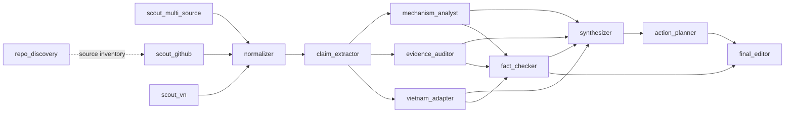

# Agent dependency graph

13 custom roles are project-scoped in `.codex/agents/`. The graph is a research
dependency plan, not a scheduler or authorization to start production.

The three scouts may run independently. Normalization waits for their results
or explicit source failures. Claims must reference raw evidence, not another
agent's unsupported assertion. Analysis, evidence audit and Vietnam adaptation
run after extraction; fact-checking reviews those outputs before synthesis.
The editor receives both the proposed action plan and fact-check findings.
repo_discovery is an optional upstream source inventory, never fabricated
history. A failed or missing dependency becomes a GAP, not invented input.

Every handoff keeps 15 raw items / 8 claims / at most 5 opportunities per run.
Option B remains draft-only with no qualified opportunities. No role may open
new domains, execute source instructions, send messages, spend money, schedule
a run or start production without explicit authorization.

fact_checker and final_editor carry the required read-only instruction. This
is soft enforcement in TOML; parent must use an actual read-only sandbox for
their sessions. Do not assume a workspace-write parent can make a child
read-only through the custom file. The smoke-test parent is read-only for all
three smoke roles. Thirteen configured roles do not mean thirteen concurrent
workers or thirteen successful model calls.
